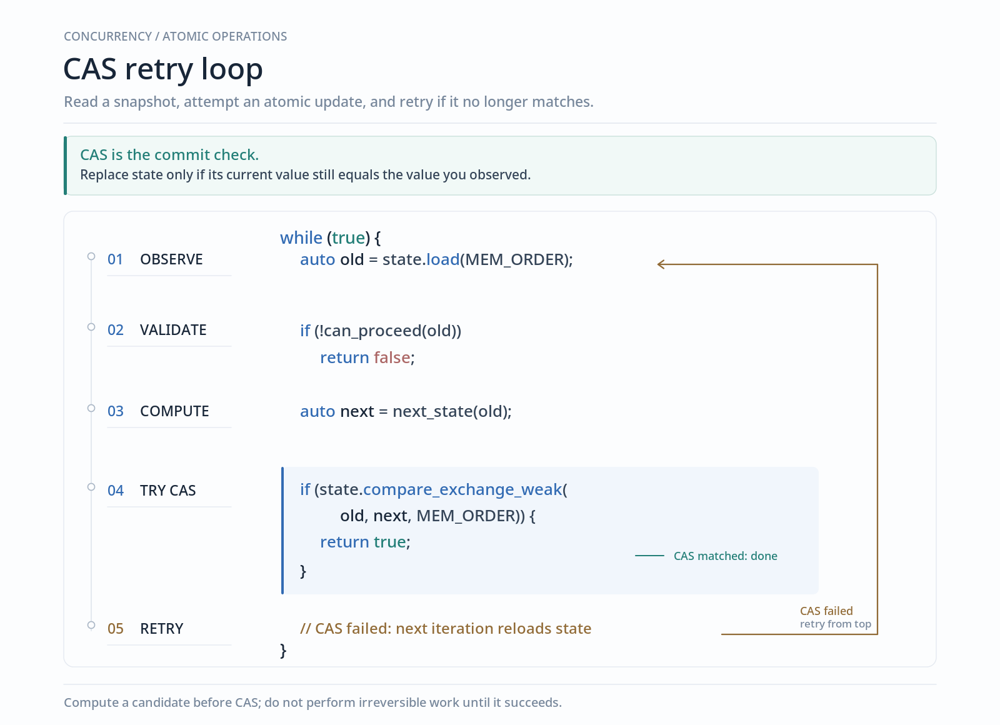
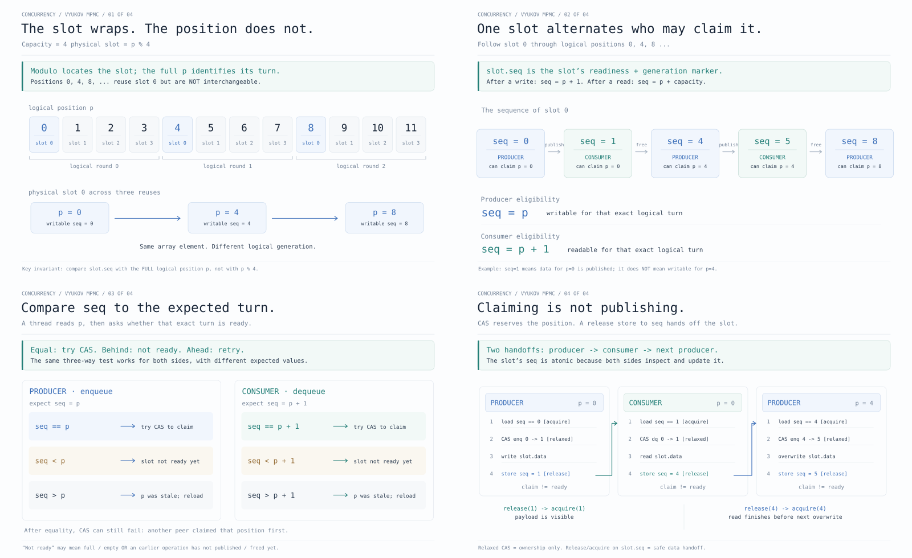

# Essential patterns in producer consumer problem

Defining the problem:
You have $P$ producers and $C$ consumer threads. Producers would do an $enq$ operation on a shared queue and
consumers would do a $dq$ operation. The entire thing should be thread safe.

Key things to consider

- what is the size of the queue? is there a predefined limit or do we just allow it to grow dynamically?
- Does the element size matter? Not really, as you can always do "ticketing"
- Is it blocking on full/empty or do we us try semantics?

## Garden of ignorance

The whole thing would not be much of a problem if you could just lock the whole queue as an operation and
fix concurrency issues but having no concurrency at all; serialising the entirety of queue access but it's still
worth knowing how to do that, as the first step.

**_Some elements_**

You'll always need a `std::queue`, even better if it's a generic queue like `std::queue<T>`.
An `std::size` is fixed at start.

Two operations would be a `push(T elem)` and a `T pop()`, guarantees being `push` is only called by the producer
while pop is only called by the consumer thread.

_**How do we sync? the forever reliable mutex?**_

Start with the usual `std::mutex` and `std::condition_variable`. What notifications do I want?

- When producer pushes, I want to notify the consumer that there's a new item in case it's waiting on empty
- When consumer pops, I want to notify the producer in case it's waiting on full ( note that a full will only happen
  on the bounded case )

> Reminder: naming of cv variables should be "what condition is it waiting on to be true". It then allows you to know
> WHEN does the cv continue processing on just by the name itself.

The implementation then is just writing code.

<details>
<summary>
A simple impl on the idea
</summary>

```cpp
template <typename T>
class BlockingQueue {
   private:
    std::queue<T> q_;
    std::mutex mtx_;
    // naming is who notifies: prod_cv => prod notifies
    std::condition_variable prod_cv_, cons_cv_;

public:
const std::size_t size;
BlockingQueue(std::size_t size) : size(size) {}

    void push(T elem) {
        // ignoring copy here
        {
            std::unique_lock<std::mutex> lck(mtx_);
            // push needs to wait till a consumer notifiers of a pop
            cons_cv_.wait(lck, [&] { return q_.size() < size; });
            q_.push(elem);
        }
        prod_cv_.notify_one();
    }

    T pop() {
        T elem;  // needs T to be default constructible
        {
            std::unique_lock<std::mutex> lck(mtx_);
            // pop needs to wait till a producer notifiers of a push
            prod_cv_.wait(lck, [&] { return !q_.empty(); });
            elem = q_.front();
            q_.pop();
        }
        cons_cv_.notify_one();
        return elem;
    }

};

```

</details>

Note, how `T` needs to be default constructible in this impl. Actually, a full list is this

- `T elem` = default constructible
- `q_.push(T)` = copy constructible
- `elem = q_.front()` = copy assignable

**semas are the "fork()" of synchronisation**

So bizzare when reading about for the first time but a counter is all you need.

Even this "two buckets" idea of using semas is something that you'll see a lot, it's an essential pattern of
"bounded usage".

Consider two buckets, $free$ and $taken$ and $n$ tickets, that $n$ here is the queue size.
A ticket is basically a pass to allow access, a producer here would need a $free$ ticket implying that there are
free slots and a producer can push.
A consumer similarly needs a $taken$ ticket to pop out the item.
Note that each "slot" in the queue can either we free or taken so tickets move from one bucket to the other.

The rest is just impl.

<details>
<summary>

</summary>

```cpp
template <typename T>
class BlockingQueue {
    ...
    std::counting_semaphore<1000> free_, taken_;
    ...

    void push(T elem) {
        // wait for free to acuire ( take ) a slot
        free_.acquire();
        {
            // you STILL need a lock as there can be MULTIPLE producers, so need to serialise
            // still
            std::unique_lock<std::mutex> lck(mtx_);
            q_.push(elem);
        }
        taken_.release();
    }

    T pop() {
        T elem;
        taken_.acquire();
        {
            std::unique_lock<std::mutex> lck(mtx_);
            elem = q_.front();
            q_.pop();
        }
        free_.release();
        return elem;
    }
};

```

</details>

Now so far, these implemenations are nice and good but don't really allow any parallel at all, contention for the queue
if high enough would serialise the whole thing losing much of the threading gains.

## Do you remember a ringbuffer?

A ringbuffer is basically a way to make a bounded queue such that it has 0 allocation overhead.
Note that in our implementations above, there was 0 real reason to have it bounded, in fact you can just drop size in the
first impl very easily. On the sema impl, you can treat `free` as $inf$ and `free.acquire()` then always succeeds, so
all you need is a `taken`.

Ideally I could've/should've used a ringbuffer in both of those, it's SOME gain atleast. But that's enough sidetracking...

**Elements of a ringbuffer**
You obviously need a `std::array<T,N>` where `T` is elem type and `N` is queue bound. `T` needs to be default constructible
but then you can always wrap it in a pointer if your type is not.

Then `head` and `tail` indexes. The most common impl for ringbuffers is the "one less is full"; the problem being it's
impossible to know if the queue is full or empty by just doing `head == full` unless you ACTUALLY check the element
at that position ( which would need you to lock ).

## SPSC

The SIMPLEST level of concurrency is to ATLEAST allow producers and consumers to be able to work in parallel.

**Bounded blocking queue** is the most common implementation for this SPSC problem, what primitives you use to sync
are another matter.

Single producer, single consumer **BUT** now both producer and consumer can access the queue simultaneously ( most of the time ), that is the biggest win we have here.

Another thing we are skipping is the non-atomic version of an SPSC, as well if you are this stage, you could just easily translate the two atomics to two mutex-cv pairs, the atomics one just translates if you really wish so.

_**What does an SPSC buy us?**_

If we are limiting to JUST one producer and one consumer, what it allows us to do is ASSUME that head would only be
modified by producers and tail only by consumers. Of couse, reads can be done by any.

That is the first thing, second more subtle one is to note that producers can ONLY make the queue "more full" and
consumers can only make it more empty.

Why is that useful? It allows to

- Know for sure that the queue state when read by producer thread is "not full", it CANNOT be made full by another
  race ( as only one producer ).
- Same for consumer, if it's empty, it could not have been raced by ANY other consumer.

**Elements of atomics**

Memory ordering is perhaps the trickiest part of it, I've done writeups on that so here we're just concerned with what
it entails for this specific problem.

Some rules

- Ordering is not for atomicity, that is always there, rather reordering boundaries for OTHER instructions
- If I'm the "owner", I can just read it relaxed as no one else is going to modify
- If I want to see something that someone ELSE can change, I need acquire
- If I want someone else TO SEE my changes when THEY acquire, I need release

<details>

<summary>
Putting it all together gets you this implementation.
</summary>

```cpp
template <typename T, std::size_t N>
class SPSC {
    static_assert(N >= 2, "need atleast 2 size");
    // think of cases 0 and 1, modulo issues there

   private:
    std::array<T, N> array_;
    // align in diff cache lines
    alignas(64) std::atomic<int> head_{0}, tail_{0};

   public:
    bool try_push(T elem) {
        // READ needed vars at start, that's easier and less error prone for
        // impl this can be relaxes because push owns tail
        int tail = tail_.load(std::memory_order_relaxed);
        // head used by cons so need sync
        int head = head_.load(std::memory_order_acquire);

        int next_tail = (tail + 1) % N;
        if (next_tail == head) return false;

        // if we reach here, it's not full. single producer so not possible for
        // something else to modify
        // a pop only makes it more empty

        // array_[tail_] is same as array_[tail_.load()] as it gets converted
        // implicitly but rather just use the created var
        array_[tail] = std::move(elem);
        // note that we only publish AFTER modifying the data

        // release lock / publish
        tail_.store(next_tail, std::memory_order_release);
        return true;
    }

    std::optional<T> try_pop() {
        // only cons reads head, so relaxed
        int head = head_.load(std::memory_order_relaxed);
        // prod reads to need sync
        int tail = tail_.load(std::memory_order_acquire);

        // rem: [open,close) semantics
        if (head == tail) return std::nullopt;

        // modify data
        T ret = std::move(array_[head]);

        head = (head + 1) % N;
        // then publish
        head_.store(head, std::memory_order_release);
        return ret;
    }
};
```

</details>

The good thing about try semantics is that they take the burder of "looping" to the caller.

**I don't want to try...**

is where `wait` comes into play. All of `wait` is these two calls.

- `tail.wait(old_tail, std::memory_order_acquire)`

Internally it's not a busy spin but behavior is identical to this while loop.

```cpp
while (tail_.load(std::memory_order_acquire) == old) {
    // Block until notified, or wake spuriously.
}
```

- `tail.notify_one()`

and since it's not a busy spin, is why you need to notify for when to re-check.
Though, you would write it as a busy or yielding spinlock.

<details>

<summary>The implementation then is</summary>

```cpp
void push(T elem) {
    int tail = tail_.load(std::memory_order_relaxed);
    int head = head_.load(std::memory_order_acquire);

    int next_tail = (tail + 1) % N;
    if (next_tail == head) {
        // full
        // wait till value is different from old, this can
        // only mean that now we can write to tail
        head_.wait(head, std::memory_order_acquire);
    }

    array_[tail] = std::move(elem);
    tail_.store(next_tail, std::memory_order_release);
    // notify if waiting in pop
    tail_.notify_one();
}

T pop() {
    int tail = tail_.load(std::memory_order_acquire);
    int head = head_.load(std::memory_order_relaxed);

    if (head == tail) {
        // empty
        // if tail changes, something was pushed and we continue
        tail_.wait(tail, std::memory_order_acquire);
    }

    T elem = std::move(array_[head]);
    head = (head + 1) % N;
    head_.store(head, std::memory_order_release);
    head_.notify_one();
    return elem;
}
```

</details>

## How deep does the rabbithole go?

There are specialised implementations for SPMC and MPSC as well but I'm going to skip those for now.

## You MUST know CAS

The image is the whole idea, you must know it as a `cas update(what update)` as that is how I try to treat it as;
a blackbox that allows me to update something.



## The ALMOST holy grail

is Vyukov's MPMC, it's called ALMOST because it's not theoretically lock free ( it's "lockless" ) but is the one
you'll most likely see being used as it's practically performant enough.

There are several key ideas here, we need to go over them incrementally.

**An ever increasing logical index**

The idea is of a logical positions that wraps and maps to actual physical positions in the ring buffer.
This allows you to use those logical positions as both readiness markers as well as generation counters.

**What atomics?**

A head and tail are obviously needed. What you ALSO need is an atomic tied to each physical slot, which like I mentioned
would be used to check readiness and generations.

Interpret seq as "logical turn for which this slot is ready". Naturally the initial values would be iota.

**No better way than to read the code**

```cpp
bool try_enq(T data) {
    while (true) {
        // 1. OBSERVE
        std::size_t p = tail_.load(std::memory_order_relaxed);
        Slot& slot = buff_[p % N];

        std::size_t seq =
            slot.seq.load(std::memory_order_acquire);

        // 2. VALIDATE
        if (seq < p) return false;  // not yet writable
        if (seq > p) continue;      // stale position

        // seq == p: ready for this producer

        // 3. COMPUTE
        std::size_t next = p + 1;

        // 4. CAS — CLAIM
        if (!tail_.compare_exchange_weak(
                p, next, std::memory_order_relaxed)) {
            continue;              // another producer won
        }

        // 5. ACT + PUBLISH
        slot.data = std::move(data);

        slot.seq.store(next, std::memory_order_release);

        return true;
    }
}


std::optional<T> try_dq() {
    while (true) {
        // 1. OBSERVE
        std::size_t p = head_.load(std::memory_order_relaxed);
        Slot& slot = buff_[p % N];

        std::size_t seq =
            slot.seq.load(std::memory_order_acquire);

        // 2. VALIDATE
        if (seq < p + 1) return std::nullopt; // not readable
        if (seq > p + 1) continue;             // stale position

        // seq == p + 1: ready for this consumer

        // 3. COMPUTE
        std::size_t next = p + 1;

        // 4. CAS — CLAIM
        if (!head_.compare_exchange_weak(
                p, next, std::memory_order_relaxed)) {
            continue;                         // another consumer won
        }

        // 5. ACT + PUBLISH
        T elem = std::move(slot.data);

        slot.seq.store(
            p + N, std::memory_order_release
        );

        return elem;
    }
}
```

Note how only the seq loads are synchronised and not head or tail, which are both relaxed reads.


